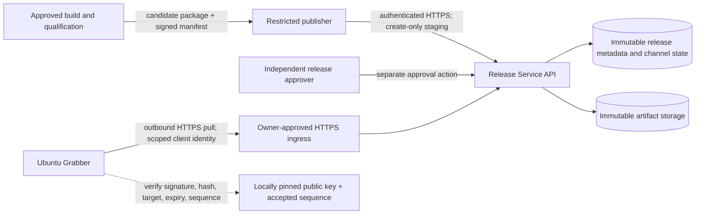

# MPIPS Production Release Service

## Status and scope

This is a reviewable proposal, not approved architecture, an executable implementation task, or deployment authorization. It covers secure distribution of approved MPIPS software updates to Ubuntu Grabber installations. The separate MPIPS API operational incident is an independent workstream and does not block this architecture; shared-host capacity, ingress ownership, and change-window risks still affect a host deployment.

No production host, runner, network, secret, or service was contacted or changed while preparing this record. Production Release Service implementation remains unauthorized until this ADR and the required owner decisions are approved and a validated task is published.

## Verified repository facts

- Phase A builds target-specific offline wheelhouse candidates and Ed25519-signs exact metadata bytes. `scripts/runtime_release.py` verifies signature, schema/interface, expiry, monotonic sequence, compatibility, package identity, size, and SHA-256.
- Phase B1 adds a standard-library reference server bound only to `127.0.0.1`, with local storage, synthetic in-memory roles, immutable release records, compare-and-swap channel promotion, and no remote publishing path. It is test/reference behavior, not a production service.
- The Grabber owns update checking, signature and package verification, accepted-sequence state, installation, activation, and rollback. Existing handoff requires keeping the installed runtime available when update checks fail and never activating merely because a signature verifies.
- Production MPIPS Compose is a separate project pattern candidate: API is loopback-published on `127.0.0.1:8014`; Redis is not host-published; API and Redis use the `mpips-internal-beta-v1` network, while only API also joins `mhcs-mpips-integration-v1`. Compose applies per-service CPU/memory/PID limits and restrictive container settings. These are facts about the checked-in configuration, not proof of its deployed state.
- The read-only infrastructure audit documentation states that approved Release Service subnet and HTTPS ingress identity/source are unknown and that the audit is not capacity certification. The supplied historical audit result reports Ubuntu 24.04+, x86_64, large CPU category, 16–32 GiB total/available RAM category, sufficient disk categories, low observed CPU load, Docker/Compose available, more than 15 running containers, expected MPIPS networks present, and ports 80/443 occupied. These coarse observations do not establish workload headroom, port ownership, or ingress approval.
- `origin/main` was read as `0e33129ff48ba99efc238b7210d9018dbd4ad26b` before drafting; the initial checkout was clean at that revision.

## Proposed minimum viable production topology

Use one standalone Docker Compose project and a small Release Service API on an owner-approved host. The service has no dependency on the clinical MPIPS API, its Redis, worker launcher, or MHCS integration network. Expose no container port directly to the public network. Attach the API only to a dedicated internal Docker network and connect ingress through an explicitly approved, narrow path. Do not attach it to either existing MPIPS network. Do not select a subnet in this ADR: the current candidate range and conflicts are unknown; the network owner must allocate and approve a non-overlapping subnet before implementation.

The service separates control-plane operations (stage, qualify, approve, publish, promote, revoke) from read-only client discovery and download. Keep API and metadata/channel state in one minimal service initially; store large package bytes in an immutable filesystem-backed artifact area mounted only where required. Avoid a new database, queue, Kubernetes cluster, or public object-store dependency until availability or scale evidence justifies it. If the selected ingress cannot reach an isolated Compose project without joining an existing workload network or exposing a host port, stop and revisit the topology rather than widening trust implicitly.

## Trust, security, and release controls

- **Transport and ingress:** Grabbers make outbound HTTPS requests; no inbound hospital connection is needed. An owner-approved DNS name resolves to the approved ingress. The ingress terminates TLS using an owner-managed certificate lifecycle with automated renewal/expiry alerting. The backend hop is private and authenticated or protected within an explicitly approved host boundary. Port 443 occupancy alone is not evidence of an approved proxy. DNS, certificate authority, TLS policy, ingress operator, and backend reachability are owner decisions.
- **Client identity:** Require per-installation or per-site client identities with read-only scope, revocation, rotation, and audit identity. Do not use a shared fleet-wide bearer token. A short-lived token issued by an existing identity provider is preferred if one is already approved and operable; otherwise evaluate client certificates as the smallest controlled alternative. No identity provider is evidenced here, so the mechanism remains open. Publisher, approver, operator, and reader privileges are distinct; human approval must not be inferred from an API string or CI success.
- **Publication workflow:** Build and qualify immutable candidates first. A publisher may create a candidate only; independent authorized release approval is a separate identity/action. Promotion changes a channel pointer atomically with compare-and-swap and append-only audit history. Enforce create-only release identity, target/channel match, monotonic sequence, and no silent overwrite. Require an explicit second-person approval for production promotion. Keep channel rollback as a new higher-sequence signed release pointing to previously approved known-good bytes, while the client rejects replay/downgrade.
- **Artifact authenticity:** Preserve Phase A Ed25519 signatures over exact metadata bytes and the package hash/size checks. The service transports and independently checks signatures but does not become the trust root. Grabbers pin a public verification key locally and verify signature, schema/interface, target, expiry, hash/size, and persisted sequence before staging/install. Key rotation requires an authenticated client trust-update path or an overlap period with both trusted keys; emergency revocation and offline clients need an owner-approved recovery procedure. Keep private signing keys out of the service and ordinary CI: use owner-approved offline/HSM or managed signing custody with narrowly controlled signing access, rotation, revocation, recovery, and key-use audit. The concrete custody choice remains open.
- **Compatibility and safe update:** Keep release manifests versioned and immutable; define supported Ubuntu/Python/architecture/glibc targets and minimum client interface. Reject unknown schema/interface, unsupported target, expired metadata, invalid signature, stale sequence, and hash/size mismatch before install. Grabber downloads into a bounded temporary area, verifies fully, installs into a new version directory, performs a local health/smoke check, then atomically switches activation while retaining the last known-good version. Never interrupt an examination; honor the Grabber's examination lock. Rollback is local and immediate to the previous version, with server-side rollback represented as a new higher sequence. Failed or unavailable update checks preserve current operation.
- **Data boundary:** Accept only signed software packages and control metadata. Reject clinical records, arbitrary uploads, callbacks, and user-supplied URLs. Sanitize responses/logs; do not emit tokens, signing material, patient data, or raw package content.

## Storage, retention, backup, and restoration

Store immutable package objects and exact signed metadata/signatures under a dedicated, access-controlled persistent volume or filesystem path, outside container writable layers and outside MPIPS/MHCS data paths. Keep mutable channel pointers and append-only approval/promotion/audit records in durable state with atomic updates. Enforce quotas and reject uploads before storage exhaustion. Do not use `/tmp` or an unbounded host directory for durable release data.

Back up artifacts, metadata, channel history, and required configuration to an owner-approved off-host, encrypted, access-controlled destination. Back up public verification material and recovery instructions; never back up private signing keys into the service backup. Define retention by release lifecycle and compliance owner: retain every promoted release and its audit trail for the approved support/rollback period; garbage-collect only unreferenced candidates after a documented grace period and approval. Test restoration into an isolated instance, verify signatures/hashes and channel history, and record recovery time/data objectives before production. Destination, retention duration, RPO/RTO, and restore operator are open decisions.

## Capacity, availability, and operations

The audit's low load and 16–32 GiB RAM category are a snapshot, not spare capacity. More than 15 containers and shared production workload introduce contention and correlated host failure. Before choosing same-host placement, measure peak CPU/memory/disk/network utilization, disk growth, backup headroom, concurrent downloads, and existing workload impact over a representative period. Set explicit API CPU/memory/PID limits and upload/download concurrency, request/time limits, rate limits, and per-client bandwidth policy. Stream downloads and uploads; never buffer multi-gigabyte packages in RAM. Size disk for retained release set plus temporary upload and backup margin. Initial values must come from measured package sizes and expected fleet/update window, not the audit categories.

For MVP, target a single active service with health monitoring, restart policy, tested backup/restore, and documented manual recovery. Do not claim HA from a single host. Observe request/error/latency rates, active downloads, bytes, free disk, service health, backup freshness, certificate expiry, auth failures, release/promotion audit events, and signing-key events; alert on disk threshold, failed backup/restore checks, certificate expiry, repeated auth failures, and service unavailability. Logs retain release/client identifiers only where approved and contain no secrets or patient data. Define an operator runbook, escalation owner, maintenance window, and recovery procedure. A separate host materially improves isolation and availability but still needs independently operated ingress and backups.

## Alternatives

| Option | Operating cost | Operational burden | Isolation/security | Capacity | Deployment complexity | Assessment |
|---|---|---|---|---|---|---|
| Separate Compose project on existing production host | Lowest incremental infrastructure cost | Shared host lifecycle, patching, monitoring, storage, and incident coordination | Process/container boundary helps; host/kernel, disk, ingress, and resource contention remain shared. Dedicated network and Unix/storage permissions required. | Unknown; current audit is not capacity evidence. | Lowest if approved ingress can route privately and network/storage are available; risks existing workload coupling. | **Preferred MVP only if** owner approves host sharing, ingress path, subnet, measured headroom, and recovery controls. |
| Separate VM or host | Higher compute/storage and maintenance cost | Separate OS patching, monitoring, backup, network, and ingress ownership | Stronger workload and failure isolation; reduced blast radius. | Independently measurable and expandable. | Moderate; needs host provisioning, DNS/TLS, firewall/network and operational ownership. | Prefer if same-host headroom, isolation policy, or availability cannot be demonstrated. |
| Managed external artifact distribution | Usage/vendor cost; potentially lower bandwidth cost through CDN | Lower artifact-serving operations, but vendor, identity, policy, audit, and origin workflow still need ownership | Strong delivery edge options; control-plane/auth and origin/key custody remain critical. Data residency, access logs, and vendor trust must be approved. | Usually best download scale, subject to selected service limits and egress design. | Highest initial integration/vendor/security review; may simplify later fleet growth. | Revisit when fleet size/download bandwidth or availability justifies external service; not minimum viable before vendor and data policy are known. |

## Evidence and decision matrix

| Classification | Evidence or statement | Consequence / confidence |
|---|---|---|
| Verified repository fact | B1 local reference protocol and implementation are loopback-only, synthetic-role, local-filesystem test behavior. | Production API/auth/storage behavior must be separately designed; do not expose the reference server. |
| Verified repository fact | Grabber verifier checks Ed25519 signature, exact metadata snapshot, target, expiry, sequence, package filename, size, and digest; installation/activation belongs to Grabber. | Reuse this trust contract; server transports, it does not replace client verification. |
| Verified repository fact | Production Compose binds MPIPS API to host loopback 8014; Redis is private; checked-in external networks are `mpips-internal-beta-v1` and `mhcs-mpips-integration-v1`. | Release Service must be isolated and must not join these networks by default. |
| Verified historical production audit evidence | Supplied historical result: Ubuntu 24.04+, x86_64, large CPU, 16–32 GiB total/available RAM, sufficient disk categories, low observed load, Docker/Compose, >15 running containers, expected MPIPS networks, ports 80/443 occupied. | Useful screening evidence only; not workload certification, ingress identity, or current live-state proof. |
| Verified historical audit limitation | Audit docs say candidate subnet conflict and approved HTTPS ingress identity are `unknown`; audit is sanitized/read-only and not capacity certification. | No subnet, proxy, DNS, or TLS owner may be inferred. |
| Architectural assumption | Existing host may run an additional isolated Compose project without degrading clinical workloads. | Must be validated with representative utilization and owner approval; otherwise use separate VM/host. |
| Architectural assumption | An approved ingress can route to a dedicated isolated backend without joining MPIPS/MHCS networks or exposing an unsafe port. | Verify ingress topology and network policy before implementation. |
| Proposed decision awaiting owner approval | Start with standalone Compose on the existing host, dedicated network and durable storage, one active API, owner-approved ingress, outbound Grabber pulls. | Minimum operational complexity if all gates pass; no deployment authority implied. |
| Proposed decision awaiting owner approval | Separate reader/publisher/approver identities; immutable signed releases; independent approval and CAS promotion; clients remain signature-verification authority. | Approve role owners, approval quorum, and promotion/audit policy. |
| Unknown requiring further evidence | Current service incident state, ingress/ports 80/443 owner, DNS/TLS provider/lifecycle, host firewall/routing and approved backend path. | Obtain owner-provided evidence; do not use the API incident as a blocker to this draft. |
| Unknown requiring further evidence | Candidate subnet, network conflict, resource headroom, package sizes, fleet count, update concurrency/window, bandwidth, storage growth, backup destination and restore targets. | Required for final host/capacity decision and resource limits. |
| Unknown requiring owner decision | Client identity mechanism, signing-key custody/rotation/revocation, retention, RPO/RTO, approval separation, support lifecycle, licensing clearance. | Must be resolved before an executable service task can be validated. |

## Minimum owner decisions to unlock implementation planning

1. **Placement and ingress:** approve same-host Compose conditionally or select a separate VM/host; name the ingress/DNS/TLS owner and approved private backend path; approve a non-overlapping network allocation. Attach measured capacity evidence as a prerequisite for same-host choice.
2. **Trust and authority:** name the release, publisher, approver, client-identity, and signing-key owners; approve client authentication, approval separation/quorum, key custody/rotation/revocation, and supported-target/client-compatibility policy.
3. **Operations and data policy:** approve artifact/audit retention, encrypted backup destination, restoration owner, RPO/RTO, monitoring/on-call responsibility, and capacity/download targets. Confirm software redistribution/licensing approval route.

These are grouped decisions; implementation planning may proceed once each group has a recorded accountable owner and sufficiently concrete answer. The separate API incident can continue independently.

## Proposed Phase B2 implementation work packages (not executable tasks)

1. **Architecture and operations closure:** record the above decisions, resource envelope, subnet/ingress path, data lifecycle, threat model, and runbook ownership.
2. **Release control plane:** implement a standalone minimal API and isolated Compose project; immutable staging, independent qualification/approval, audited atomic channel promotion, and role-scoped authorization.
3. **Artifact and recovery plane:** enforce bounded streaming and quotas; durable immutable storage; encrypted backup/restore and retention jobs; metrics, alerts, and audit records.
4. **Grabber client integration:** add authenticated HTTPS discovery/download, bounded staging, existing signature/hash/compatibility/sequence checks, no-interruption activation, and local rollback. Preserve operation when service is unavailable.
5. **Qualification and release readiness:** synthetic and target-OS tests, security review, load/resource test, restore drill, ingress/TLS/auth validation, independent implementation review, and separate production Release Gate.

Dependencies are sequential: work package 1 precedes executable tasks for 2–4; package 5 validates the integrated result. No implementation task is published by this ADR.

## Acceptance criteria for this architecture review

- [ ] Owner reviews and explicitly approves or rejects each proposed decision and the three decision groups above.
- [ ] Ingress, DNS, TLS termination/renewal, backend path, host placement, and network allocation have named owners and evidence; unknown values remain marked unknown until then.
- [ ] Same-host recommendation has representative resource, network, disk, and download-capacity evidence; audit categories are not used as certification.
- [ ] Client identity, role separation, approval quorum, signing-key custody/rotation/revocation, and client trust-update/recovery are approved.
- [ ] Manifest compatibility, monotonic sequence, channel promotion, rollback, immutability, and safe Grabber activation are reconciled with B1 and current client behavior.
- [ ] Artifact retention, backup destination, restore test, RPO/RTO, monitoring, alerting, and operating ownership are approved.
- [ ] Licensing/redistribution route and supported fleet targets are confirmed before release implementation is authorized.
- [ ] Independent architecture/security review records findings and resolution. After approval, Planner creates a bounded validated task; no deployment follows implicitly.

## Consequences and boundary

Conditional same-host Compose minimizes initial infrastructure and deployment complexity but inherits shared-host failure, contention, and ingress risks. A separate host is the fallback if evidence or policy does not support sharing. Managed distribution remains a scale/availability option, not a prerequisite. The Release Service is software distribution infrastructure only and must remain isolated from patient data and clinical conversion paths.

**Decision owner:** Repository/product infrastructure owner and designated security/release authorities
**Approval:** Pending — Architecture Review Required
**Release status:** Release Service Not Authorized for Deployment
