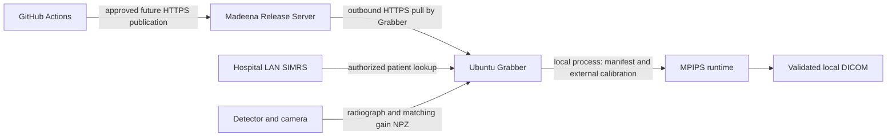

# Ubuntu Grabber integration and distribution handoff

Start here for a separately developed Grabber. MPIPS owns image processing,
validated DICOM, the local executable, candidate packaging and release tooling.
Grabber owns SIMRS HTTP access, patient confirmation, acquisition/drivers, update
installation and activation. Hospital and infrastructure owners approve their
networks and clinical/release policies. This guide does not authorize clinical
use or release.

## Delivery status

| Boundary | Status |
|---|---|
| `mpips-runtime` interface 1 and existing Python converter | Implemented; automated synthetic conversion/error tests |
| Offline wheelhouse builder and installed BED/TRX smoke | Implemented; qualification evidence is in `.agents/evidence/ubuntu-grabber-runtime.md` |
| Ed25519 signing, exact-byte verification, target/hash/expiry/sequence checks | Implemented local tooling; test keys only |
| Authenticated publication preparation | Implemented local plan generation; no uploader/server or production keys |
| Versioned release distribution reference | Implemented as a loopback-only synthetic fixture; no Madeena service, real approval or external publisher |
| Ubuntu 24.04 x86_64 qualification | Synthetic CI qualification passed at `2e5441f`; exact evidence in `.agents/evidence/ubuntu-grabber-runtime.md`; clinical/hardware approval remains open |
| Madeena update endpoints, promotion, activation and rollback | Proposed contracts for infrastructure owner / Grabber developer; not deployed or implemented by MPIPS |
| RSKIA SIMRS endpoint and field names | Human-supplied observed evidence; address/auth/errors/types/date and sex semantics unverified |
| Clinical/hardware qualification and binary redistribution | Pending separate approval, including ImageJ-style licensing review |

## Architecture and network boundaries



The release server transports software only. Never route patient records or
SIMRS access through it. Grabber needs no inbound access from Madeena. The private
MPIPS API on `127.0.0.1:8014` remains a separate HTTP service, not an artifact
endpoint. Local CLI processing starts no API server, Docker launcher, Celery or
Redis daemon and makes no network requests.

Keep version directories (software), read-only detector calibration, site
configuration, examination storage and update trust/sequence state separate.
Suggested operator-controlled layout, not a required system installation:

```text
<install-root>/versions/<release-id>/runtime/  # venv; executable and libraries
<install-root>/current                       # Grabber-managed symlink
<calibration-root>/<detector-profile>/       # independently approved assets
<config-root>/                              # site config; trusted public key
<clinical-root>/<examination>/               # NPZ, manifest, DICOM; private access
<update-state-root>/                        # accepted sequence and previous version
```

No calibration, patient data, credentials or private signing keys enter a software
bundle. Gain NPZ is acquisition-specific and must match the radiograph identifiers.

## SIMRS patient lookup: observed evidence and unverified details

Observed endpoint shape: `GET /ap/api_reg.php?id=<no_rawat>`, with a JSON envelope
containing `success` and `data`. Evidence includes `no_rawat`, `no_rkm_medis`,
`nm_pasien`, `jk`, `tgl_lahir`, `tgl_daftar` and additional unnecessary sensitive
fields. **`no_rawat` is a visit/registration identifier, not a queue position.**

The screenshot's `127.0.0.1` identifies the machine displaying it; it is not a
verified Grabber-accessible SIMRS server. Obtain LAN hostname/port, HTTPS or
approved transport controls, authentication, roles, allowed source addresses,
response types and error semantics from the hospital owner. Do not contact a real
hospital endpoint from tests/CI or change the PHP API.

The separate Grabber developer implements the HTTP client. Intended handling:

1. Operator enters/scans the entire visit identifier as a string. Preserve leading
   zeros and separators; URL-encode the query parameter, never concatenate raw input.
2. Query the owner-approved LAN base, with authentication, bounded timeout, bounded
   response size and redirect restrictions. Require a successful HTTP response and
   JSON content. Treat HTML/PHP warnings, empty/malformed JSON and missing fields as
   failures, not patient records. Error codes and retry policy need hospital agreement.
3. Require a boolean `success == true`, one patient object, nonblank string medical
   record number/name and an exact returned `no_rawat` match. Do not coerce numeric
   identifiers. Unexpected object/list/error envelopes require contract clarification.
4. Validate dates and confirmed sex-code mappings; display only the identity fields
   needed for confirmation. The operator explicitly confirms identity before exposure.
5. Acquire image and the matching gain NPZ, capture actual timezone-aware image and
   examination timestamps, and combine identity with independently approved detector,
   view, spacing and examination metadata. Validate `MHCSManifest`.
6. Invoke MPIPS locally and require both exit zero and an `ok` status. Preserve the
   examination and inputs on failure; do not blindly re-expose/re-acquire.
7. Any downstream PACS/MHCS submission belongs to a separately authorized clinical
   integration. This task implements no clinical upload.

Use [the synthetic response](examples/simrs-response.synthetic.json) and the
[reference mapping](../../scripts/simrs_manifest_example.py) without real patient
data. The helper is a tested developer example, not an installed runtime service.
It deliberately makes **no HTTP request**. It accepts the proposed object envelope
and ISO `YYYY-MM-DD` dates only. These types/formats require confirmation at the
hospital; stop rather than guessing if real responses differ. Additional patient
fields are omitted, not copied wholesale into a manifest.

## Mapping to the actual MPIPS schema

[MHCSManifest](../../mpips/api/schemas/dicom.py) is the validation authority for
implemented MPIPS behavior. The [existing API guide](mhcs-dicom-api.md) explains
raw versus resolved manifests and metadata semantics.

| SIMRS / other source | MPIPS field | DICOM effect / restriction |
|---|---|---|
| `no_rkm_medis` | `patient.medical_record_number` | PatientID; required string, max 64; preserve identifier |
| `nm_pasien` | `patient.name` string or `{full_name: ...}` | PatientName; required; do not guess family-name parsing |
| `no_rawat` | `examination.encounter_id` | Traceability in manifest; max 64; currently **not emitted as a DICOM encounter tag** |
| confirmed `jk` mapping | `patient.sex` | `male`→M, `female`→F, `other`→O, `unknown`→empty PatientSex |
| validated `tgl_lahir` | `patient.birth_date` | PatientBirthDate; confirmed format and plausible birth date |
| actual image capture | `capture.captured_at` | Actual acquisition timestamp, timezone offset required |
| actual examination | `examination.performed_at` | Actual study/examination time; timezone offset required |
| separately authorized accession policy | `examination.accession_number` | AccessionNumber; max **16**, otherwise omit |
| detector/site clinical configuration | capture/site/dicom fields | Physical spacing, view, detector and pixel authority |

Do not map a long visit number to AccessionNumber, truncate it, hash it into a
clinical identifier or invent an accession. Accession and encounter identifiers
have different meaning. Do not use `tgl_daftar` as examination/acquisition time.
Do not invent PatientAge; MPIPS checks it against birth/examination date when all
are supplied. Use `unknown` for sex until hospital semantics are approved; an
explicit confirmed code map rejects unrecognized codes. The synthetic response's
`jk` deliberately asserts no real hospital semantics.

Patient ID/name are required by the schema. Grabber must additionally reject
whitespace-only object names/IDs: the general MPIPS schema permits some whitespace
strings. This example trims required identity strings without changing the API
schema. Missing/invalid birth data should trigger the approved hospital policy;
the reference example fails closed rather than inventing a date.

MPIPS fills omitted IDs/UIDs deterministically, and has internal fallback timestamps
and site/operator defaults. These are library conveniences, not clinical authority.
Supply actual operator/site/capture/examination metadata in real use. Preserve the
original manifest with the examination because encounter ID is not a DICOM tag.

[The synthetic complete manifest](examples/grabber-manifest.synthetic.json) is
schema-tested. Its spacing and view are **synthetic**, never a detector prescription.
Conversion also validates canonical pixel source, physical spacing and orientation;
schema validation alone does not demonstrate conversion validity. Supply
`dicom.pixel_source = CANONICAL_PRE_PRESENTATION`, the detector's approved
`pixel_intensity_relationship` / sign, and the verified spacing/view configuration;
do not label arbitrary pixels canonical just to pass a check.

## Local runtime interface 1

Install MPIPS normally using the [Python import guide](python-import-module.md), or
use a verified offline candidate bundle after release approval. The console entry
is `mpips-runtime`; `python -m mpips.runtime` is equivalent in that environment.
Pass paths as individual process arguments (no shell interpolation):

```bash
/path/to/runtime/bin/mpips-runtime --version
/path/to/runtime/bin/mpips-runtime convert \
  --radiograph /private/exam/radiograph.npz \
  --gain /private/exam/gain.npz \
  --manifest /private/exam/manifest.json \
  --calibration /approved/calibration/profile \
  --output /private/exam/result.dcm
```

`--version` returns JSON with `interface_version: "1"`, `runtime_version: "0.1.0"`,
`status: "ok"`, `code: "OK"`. Patch releases are distinguished by signed
`release_id` / full commit SHA and bundle `build.json`, not the package version alone.
Conversion returns the same status fields plus `output_byte_size` on success.
Stdout contains one JSON record; ordinary conversion errors do not echo paths,
patient fields or tracebacks. `--help` is human-readable and excluded from the
machine-status contract. Unsupported/missing arguments are sanitized.

| Exit | JSON code | Grabber handling |
|---|---|---|
| 0 | OK | Check status; consume validated DICOM |
| 2 | INVALID_INPUT | Correct manifest/NPZ/arguments; do not auto-retry |
| 3 | INPUT_NOT_FOUND | Check input and calibration paths |
| 4 | OUTPUT_EXISTS | Preserve existing examination output; choose a new explicit path |
| 5 | CONVERSION_TIMEOUT | Preserve inputs; report processing failure |
| 6 | IO_ERROR | Check storage permissions/capacity |
| 7 | CONVERSION_FAILED | Preserve inputs; report sanitized runtime failure |

The CLI calls the existing converter with explicit calibration. It privately stages
processing under a mode-0700 directory in the output filesystem, suppresses legacy
converter diagnostics, and commits a validated mode-0600 DICOM with an atomic,
no-overwrite hard link. Failure before commit leaves no output. The parent storage
must support same-filesystem hard links and be controlled by the operator; this is
not a power-loss durability guarantee. Keep clinical directories private.

The CLI selects the existing local subprocess adapter even if the calling process
inherited API production environment variables. The API production/launcher path
is untouched. CLI resource controls still use `MPIPS_DICOM_PROCESS_TIMEOUT_SECONDS`
(default 300), `MPIPS_DICOM_WORKER_CPU_SECONDS` (120) and
`MPIPS_DICOM_WORKER_MEMORY_BYTES` (2 GiB); the CLI supplies a private workspace root.
A fresh executable process is the supported boundary, not concurrent calls to its
`main()` in an application process. For Python callers use the existing import API.

BED/TRX processing, 16-bit unsigned MONOCHROME2, metadata validation and calibrated
TRX clockwise orientation remain with the established pipeline. Actual detector
qualification is separate. Calibration requires validated metadata, matching camera
serial/detector mode, image shape, gain identity, remaps/masks and approved layout;
see [the existing calibration contract](mhcs-dicom-api.md). Do not ship an identity
remap from the synthetic smoke as real calibration or silently replace invalid assets.

## Packaging choice and offline installation

The implemented minimum is an **offline wheelhouse tar.gz**, not a standalone
binary. It requires an approved preinstalled CPython **3.12**, `venv`/`ensurepip`,
compatible Ubuntu/glibc/architecture, and native wheel runtime libraries. It includes
MPIPS's wheel, hash-pinned dependency wheels, requirements, source snapshot,
`build.json`, install instructions and existing license notices. It excludes Torch,
service daemons and calibration training extras from the processing closure.

| Option | Assessment |
|---|---|
| Offline wheelhouse + system Python | Selected: reuses setuptools/uv.lock, native wheels and the existing `python -m` worker; can be installed without indexes |
| Frozen self-contained app bundle | Not implemented/qualified: must prove NumPy/OpenCV plugins and subprocess interpreter/module launching; packaging cannot alter the protected converter to simplify it |
| Debian package | Not implemented: needs target Ubuntu/Python dependency, policy, root install lifecycle and signing decisions; little benefit while real target fleet is unconfirmed |

Build from an immutable committed source revision inside the authorized development
or GitHub-hosted environment:

```bash
uv run --with pip==26.2.1 python scripts/build_runtime.py --commit <full-commit-sha> \
  --sequence 1 --output /tmp/mpips-candidates
```

The build command supplies pip explicitly because uv-created environments may
omit it; pip is a build tool, not a new runtime dependency.
The builder checks the lock, downloads only hash-checked binary dependencies,
builds the MPIPS wheel, creates a clean venv and runs installed BED/TRX DICOM smoke
outside the source tree before writing package/metadata. `--sequence 1` is a local
candidate example; the release owner must allocate monotonic production sequences.
It refuses existing artifact paths. Package names include the full commit and target.
Immutable identity does not claim byte-for-byte reproducible tar timestamps.

After authenticating metadata and verifying package bytes, safely extract with
path-traversal/symlink protections into a new private version directory. Reject
absolute paths, `..`, links/devices and unexpected members; enforce size/disk limits.
Do not run archive scripts. For trusted, verified candidate bundles:

```bash
python3.12 -m venv /absolute/new-version/runtime
/absolute/new-version/runtime/bin/python -m pip install \
  --no-index --only-binary=:all: --require-hashes \
  --find-links /absolute/bundle/wheels -r /absolute/bundle/requirements.txt
/absolute/new-version/runtime/bin/mpips-runtime --version
```

The Python prerequisite is not bundled or downloaded during processing. Provision
it through the owner-approved OS channel before an examination. Offline installation
uses [pip's local wheelhouse support](https://pip.pypa.io/en/stable/cli/pip_download/)
and [hash checking](https://pip.pypa.io/en/stable/topics/secure-installs/).

Compatibility metadata records the exact observed Ubuntu version, architecture,
Python minor and conservative host glibc minimum; verification rejects a different
OS release/CPU/Python and an older glibc. No generic "all Ubuntu" claim. A newer host
glibc recorded during local building is not proof of the true minimum. Build and
run smoke on each proposed target; record its evidence. CPU feature, native library,
full-resolution memory/performance and detector/hardware qualification remain open.

## Release metadata and authenticity

The adjacent `<package-stem>.release.json` describes schema version 1, runtime
version, full SHA, target-specific release ID, sequence, expiry, interface/manifest versions, package
filename/hash/size/format, compatibility and synthetic-only candidate status.
Metadata expires after seven days in the preparation tooling; the infrastructure
owner must approve channel validity/refresh policy. Re-signing refreshed metadata
does not require changing immutable package bytes. Never overwrite published
metadata at the same immutable identifier; use a separately versioned channel
metadata snapshot. The implementation is local preparation, not that server policy.

Detached signatures use Ed25519 over **the exact JSON bytes including newline**.
Provision the trusted public key independently in Grabber/site configuration.
Do not accept a key supplied alongside an unauthenticated download. SHA-256 alone
cannot establish authenticity. Signing keys must remain in approved secret storage;
production key provisioning/rotation/revocation is not implemented here.
The tool uses [OpenSSL Ed25519 pkeyutl](https://docs.openssl.org/3.3/man1/openssl-pkeyutl/)
with `-rawin`, validates the key algorithm, and parses the authenticated byte snapshot.

```bash
python scripts/runtime_release.py sign \
  --metadata /candidate/release.json --signature /candidate/release.sig \
  --key /approved-secret-mount/signing-key.pem
python scripts/runtime_release.py verify \
  --metadata /download/release.json --signature /download/release.sig \
  --key /trusted-config/release-public.pem --package /download/<exact-package-name> \
  --minimum-sequence <persisted-accepted-sequence>
```

Verification checks signature, metadata schema/interface, expiry, sequence,
compatibility, exact package filename and hash/size. It returns verified bytes'
identity, not distribution approval. Local candidate metadata explicitly says
`candidate-not-approved-for-distribution`. Grabber must additionally enforce an
owner-approved release/channel status and detector profile; do not auto-activate a
candidate simply because this verification succeeds. Require a reliable clock;
clock errors must fail update checks while leaving the installed runtime available.

## Phase B1 local release distribution reference (not a production service)

`scripts/release_reference_server.py` and `scripts/publish_runtime.py` implement
the testable `v1` contract below. The server is standard-library only, binds
literally to `127.0.0.1`, stores immutable release files in a local directory,
and accepts only in-memory role tokens supplied when the test server is created.
It has no remote mode, configurable bind address, TLS identity, production
credential support or patient-data route. Its qualifier, approver and promoter
roles are synthetic fixtures; their state is never production evidence. The
reference contract does not change Phase A signed metadata.

The test fixture starts and stops the server itself. Run the integration tests
with synthetic signed bytes and fresh temporary storage:

```bash
uv run pytest -q tests/test_release_distribution.py tests/test_runtime_release.py
```

For a manual local exercise, start the reference server from a Python process
with temporary tokens and an independently trusted public key. It prints only
its loopback URL; stop it with Ctrl-C:

```python
import os
from pathlib import Path
from scripts.release_reference_server import ReferenceServer

roles = ("reader", "publisher", "qualifier", "approver", "promoter")
tokens = {
    os.environ[f"MPIPS_REFERENCE_{role.upper()}_TOKEN"]: role for role in roles
}
server = ReferenceServer(
    Path("/tmp/mpips-release-reference"),
    Path("/trusted-config/release-public.pem"),
    tokens,
)
print(server.base_url, flush=True)
try:
    server.serve_forever()
finally:
    server.server_close()
```

The authenticated reference routes are:

| Method and path | Role | Request/result |
|---|---|---|
| `PUT /v1/staging/{release_id}/{sequence}/metadata` | publisher | Exact signed JSON bytes, create-only; `201` |
| `PUT /v1/staging/{release_id}/{sequence}/signature` | publisher | Exactly 64 detached signature bytes, create-only; `201` |
| `PUT /v1/staging/{release_id}/{sequence}/package` | publisher | Raw package bytes, create-only; max 2 GiB; `201` |
| `POST /v1/staging/{release_id}/{sequence}/qualify` | synthetic qualifier | Empty body; verify complete signed package; `200` |
| `POST /v1/staging/{release_id}/{sequence}/approve` | synthetic approver | Empty body; records simulated approval only; `200` |
| `POST /v1/staging/{release_id}/{sequence}/publish` | publisher | Empty body; atomically publishes the approved immutable record; `200` |
| `GET /v1/releases/{release_id}/{sequence}` | reader | Lifecycle state and exact metadata/signature snapshot, base64 encoded; `200` |
| `GET /v1/releases/{release_id}/{sequence}/package` | reader | Verified package bytes, streamed; `200` |
| `GET /v1/channels/{channel}/{target}` | reader | Current pointer and matching exact-byte metadata/signature snapshot; `200` |
| `GET /v1/channels/{channel}/{target}/history` | reader | Append-only promotion history; `200` |
| `POST /v1/channels/{channel}/{target}/promote` | synthetic promoter | `{"expected_current_sequence":0}` for empty channel, otherwise its observed sequence; `200` |

For the defined promotion body (which carries only the compare-and-swap value),
the reference implementation selects the lowest published sequence greater than
the current channel sequence whose signed Ubuntu/Python/architecture target
matches. One atomic JSON pointer contains both the current entry and history, so
concurrent callers cannot split the pointer update from its audit history. A
stale expected sequence, replay, or downgrade returns `409`. A simulated rollback
is a separately signed higher-sequence record that reuses the known-good package
bytes; sequence never moves backward. No overwrite, delete, sequence reset or
production rollback authorization is represented.

Each control success includes `schema_version: 1` and
`mode: "local-reference-only"`. Release/channel snapshots preserve the original
metadata and signature bytes together; metadata is never parsed and reserialized
for discovery. Channel history entries contain `release_id`, `sequence`,
`previous_sequence` and `promoted_at`. Paths accept only safe ASCII identifiers,
sequences are positive decimal integers without leading zeroes, and target names
follow `ubuntu-{os_version}-{architecture}-py{python}`.

Errors use the fixed envelope
`{"schema_version":1,"error":{"code":"...","message":"..."}}` and do not
echo authorization, request bytes or filesystem paths:

| Status | Code | Meaning |
|---|---|---|
| `400` | `bad_request` | Malformed path/body, missing content length or unsupported transfer encoding |
| `401` | `unauthorized` | Missing or invalid in-memory token |
| `403` | `forbidden` | Valid token lacks the required role |
| `404` | `not_found` | Unknown published release, package or channel |
| `409` | `conflict` | Immutable collision, incomplete/invalid transition, stale or replayed promotion |
| `413` | `too_large` | Metadata/control body over 64 KiB or package over 2 GiB |
| `422` | `invalid_release` | Signature, expiry, package hash/size or target verification failed |

`publish_runtime.py dry-run` runs the existing `runtime_release.verify` checks
locally and has no server option or network call. `stage` revalidates the same
inputs, requires `MPIPS_REFERENCE_PUBLISHER_TOKEN`, and uploads to an explicit
`http://127.0.0.1:<port>` server only. It stages the three immutable components;
it does not qualify, approve, publish or promote them. `promote` is a separate
command, requires `MPIPS_REFERENCE_PROMOTER_TOKEN` and an explicit loopback URL,
channel, target and expected sequence. Tokens are read from the environment,
never command arguments or output. Only the literal IPv4 loopback address is
accepted; hostnames, other IPs and HTTPS URLs are rejected by this local-only
client. The standalone phase does not implement TLS or any remote adapter.

Example artifact validation and explicit local staging:

```bash
python scripts/publish_runtime.py dry-run \
  --package /candidate/<exact-package-name> \
  --metadata /candidate/release.json --signature /candidate/release.sig \
  --key /trusted-config/release-public.pem

MPIPS_REFERENCE_PUBLISHER_TOKEN=<synthetic-local-token> \
  python scripts/publish_runtime.py stage \
  --package /candidate/<exact-package-name> \
  --metadata /candidate/release.json --signature /candidate/release.sig \
  --key /trusted-config/release-public.pem \
  --server http://127.0.0.1:<port>

MPIPS_REFERENCE_PROMOTER_TOKEN=<synthetic-local-token> \
  python scripts/publish_runtime.py promote \
  --server http://127.0.0.1:<port> --channel stable \
  --target ubuntu-24.04-x86_64-py3.12 --expected-current-sequence 0
```

The test suite starts the server with separately injected reader, publisher,
qualifier, approver and promoter tokens, runs the complete lifecycle, and shuts it
down. These synthetic tokens and approvals must never be reused for a real system.
The CI qualification adds the tests and lint checks on GitHub-hosted Ubuntu while
retaining the existing lock check, dependency audit, regression, full pytest,
offline install and installed BED/TRX DICOM smoke gates. It does not publish test
packages or connect to any service.

## Proposed Madeena HTTPS protocol (not a deployed service)

All endpoint roots, paths, auth, trust keys, storage and network rules need
infrastructure-owner agreement. A possible owner-approved protocol is:

| Operation | Proposed request/response |
|---|---|
| Version check | Authenticated `GET <base>/channels/stable/<target>/release.json` and matching `.sig`; metadata's release ID/sequence identifies the update |
| Download | Authenticated `GET <base>/releases/<release-id>/<package-filename>`; immutable bytes, declared size and signed hash |
| CI publication | Authenticated HTTPS upload of package, release.json and release.sig to an immutable staging prefix, using a short-lived owner-provisioned credential |
| Promotion | Separate authorized server-side atomic channel change after uploaded-byte verification and approvals |
| Rollback | Separately authorized higher-sequence signed release pointing to a known-good package, or local already-trusted previous installed version |

Use HTTPS certificate verification; never disable TLS or embed tokens in URLs.
Keep bearer credentials in the OS credential store/approved CI secret channel, out
of process arguments/logs/Git. Server controls must prevent overwrites, reject
partial uploads and separate publisher from downloader privileges. Fetch matching
metadata/signature snapshots; on races retry the version check and never accept an
unsigned mismatch. Enforce bounded downloads; do not follow cross-origin redirects
with credentials. Server capabilities, response codes and token/OIDC mechanism
remain proposed until the infrastructure owner supplies a real contract.

Local publication preparation can generate a reviewable **plan only** after signature
verification and recorded approval references; it makes no network request:

```bash
python scripts/runtime_release.py publication-plan \
  --metadata /candidate/release.json --signature /candidate/release.sig \
  --key /trusted-config/release-public.pem --package /candidate/<exact-package-name> \
  --minimum-sequence <accepted-sequence> \
  --endpoint https://release.example.invalid/mpips \
  --licensing-approval <owner-approved-record> \
  --infrastructure-approval <owner-approved-record> --output /tmp/publication-plan.json
```

`example.invalid` is a documentation placeholder, not Madeena infrastructure.
Approval-reference strings are traceability inputs, not an automated approval
system. A plan is not authorization to upload. No live publication implementation
or production signing workflow is supplied while licensing/infrastructure gates
remain open. Existing API deployment workflows are unchanged.

For a future approved uploader, stage the builder's `<package-stem>.release.json`
as `release.json` and its detached signature as `release.sig` under the target's
immutable release prefix. Renaming files does not change the signed bytes.

## Grabber update activation, rollback and offline behavior (developer responsibility)

1. Check signed channel metadata periodically outside examination processing;
   compare full release identity and persist the highest accepted sequence. Reject
   lower sequences, expired metadata, unexpected interfaces/targets and candidates.
2. Download into a private staging area with size bounds. Verify signature and
   size/hash **before extraction or execution**, then install into a new version
   directory offline. Preserve accepted software until all checks succeed.
3. Run version/interface check and a nonclinical synthetic smoke with approved
   calibration expectations. Do not automatically process real patient data as an
   update test. Record software/calibration identities with examination provenance.
4. Hold a Grabber-wide examination/update lock across the check and activation;
   activate only when no examination is active or queued. All runtime consumers
   must use the same lock. Pin the absolute version path at examination start so
   an active process cannot switch libraries beneath it.
5. Atomically replace `current` with a symlink to the new version on the same
   filesystem; retain the previous working version and state. Ensure installed
   venv paths remain stable (do not move an already-created venv).
6. If new-version self-check/startup fails, keep or atomically restore the previous
   version. Record failure and require operator intervention when neither version
   works. A rollback to a previously verified local version does not lower the
   stored update sequence; remote rollback uses an owner-approved newer sequence.
7. Network failure or unavailable updates never deletes/disables the verified
   installed runtime. Processing remains offline with already validated inputs
   and approved calibration. SIMRS failure is a separate patient-identity failure:
   follow the hospital's authorized offline workflow; do not guess identity or
   silently reuse a stale record. No offline patient-cache policy is invented here.

This repository does not implement the Grabber lock, updater, retention UI or
activation state. The signed local verifier is a reference building block; the
separate developer must implement the complete activation contract and test
power loss, disk exhaustion, active examinations, interrupted downloads and rollback.

## Synthetic end-to-end qualification

The checked-in [smoke script](../../scripts/grabber_smoke.py) creates only synthetic
NPZs, a synthetic identity calibration and a synthetic manifest, invokes an installed
CLI and checks BED/TRX dimensions, DX SOP class, patient fields, unsigned 16-bit
MONOCHROME2 and absence of private tags. It cleans temporary data afterward:

```bash
/path/to/runtime/bin/python scripts/grabber_smoke.py \
  --runtime /path/to/runtime/bin/mpips-runtime
uv run pytest -q tests/test_local_runtime.py tests/test_runtime_release.py tests/test_simrs_reference.py
```

The additive `qualify-ubuntu-runtime.yml` workflow uses a GitHub-hosted Ubuntu
24.04 runner on PRs, checks the lock/audited dependency closure/source/regressions,
builds the candidate and performs the offline installed smoke. It neither uploads
binary artifacts nor uses production credentials, self-hosted production runners,
deployment dispatch or promotion. The existing CI/API deployment remains intact.

Observed target evidence: [Ubuntu 24.04 x86_64 CI qualification](https://github.com/Madeena-software/mpips/actions/runs/38225063938)
passed the runtime audit, all 915 tests (2 skipped), offline bundle build and
installed BED/TRX smoke. Local Ubuntu 26.04 x86_64 / Python 3.12.14 / glibc 2.43
also passed archive verification and offline installed smoke. These are synthetic
qualification results; they do not establish clinical or detector-fleet readiness.

## Privacy and approvals still required

Run MPIPS as an unprivileged account. Restrict examination directories and backups,
encrypt storage as required by hospital policy, minimize patient display and
retention, and avoid logging complete manifests, NPZ metadata, HTTP responses or
exception contents. DICOM itself carries patient identifiers: do not send it to the
software release server. Do not include clinical folders in diagnostic bundles.

Before real deployment, owners must close:

- **Repository/licensing owner:** combined-distribution assessment of
  [THIRD_PARTY_NOTICES.md](../../THIRD_PARTY_NOTICES.md), GPL-v2 ImageJ-style code,
  source/notice/dependency obligations and MPIPS's overall licensing. Bundling the
  existing GPL text/source does not resolve that assessment. No external binary
  redistribution is authorized before closure.
- **Infrastructure owner:** real release host/storage, publisher/downloader auth,
  TLS/network policy, trusted signing key/rotation, monotonic sequence allocation,
  promotion/rollback authority, expiry/refresh, retention and audit.
- **Hospital/SIMRS owner:** actual LAN address/port/auth/access control, envelope and
  field types/date format/sex codes, not-found/error behavior and approved offline policy.
- **Clinical owner:** accession policy, encounter traceability, operator confirmation,
  actual timestamps/site/operator metadata, downstream submission authorization.
- **Detector/Grabber owner:** Ubuntu/CPU/Python fleet, native compatibility, full-size
  resource budget, real detector gain/camera/calibration/view/spacing qualification,
  update lock, atomic activation, previous-version retention and rollback testing.
- **Independent reviewer:** implementation acceptance of the exact task and commits;
  acceptance is separate from release authorization.
